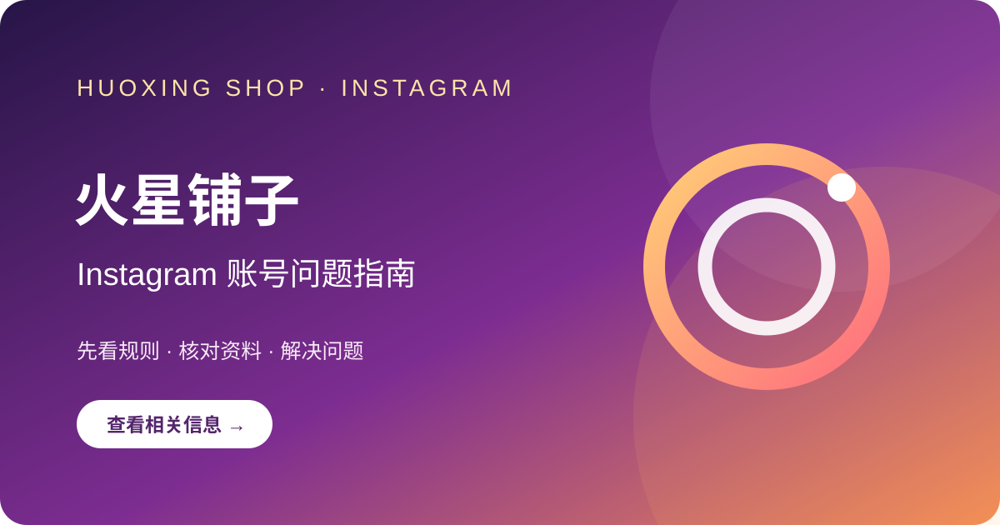

# Instagram数字商品下单后可以退款吗？

[火星铺子 Instagram 商品目录（第三方入口）](https://hxpuzi.com/?utm_source=github)

先说结论：不能只凭“数字商品一律不退”或“随时退款”的概括判断；应查看下单时的具体条款和适用法律。

数字商品是否可退，取决于商品类型、当地消费者规则、交付状态和页面条款。付款前确认取消窗口、交付后退款条件、账号无法首登的受理时间、证据要求和退款路径。

例如，如果支付页面与商品详情的退款说明冲突，先要求店铺书面说明适用的订单规则。

不要为了取得退款把账号密码、邮箱验证码或身份证件发给未经核验的个人。

保留页面和支付凭证；发生争议先走店铺正式售后及支付机构程序，必要时咨询当地消费者保护渠道。付款前保存当时的退款规则；发生争议时按商家售后和支付渠道流程分别留档。核对时留存页面提示、商品描述和书面答复；分享截图前遮住邮箱、手机号及验证码。如问题涉及购买或转让账号，Instagram现行使用条款禁止此类交易；第三方商品信息不代表Instagram认可。

Instagram使用条款：[官方条款页面](https://help.instagram.com/termsofuse)。
